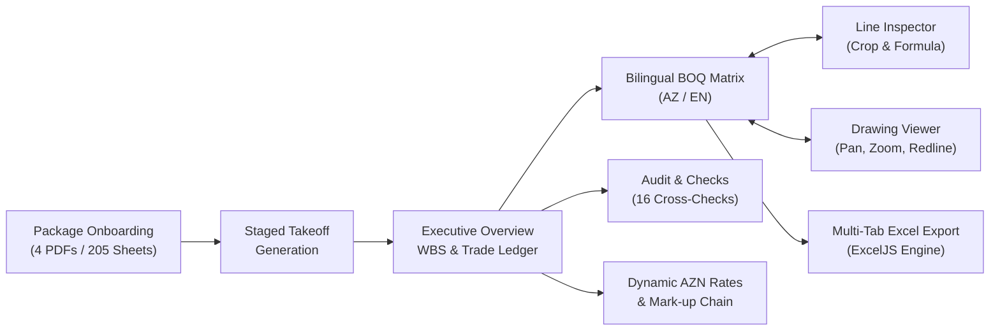

# Tutulan — Automated Construction Takeoff & BOQ Platform

> **Zero-black-box Bill of Quantities (BOQ) takeoff platform for Azerbaijani working-design packages, featuring pixel-level redline drawing evidence, interactive blueprint visualization, automated cross-discipline audit checks, and audit-grade Excel reporting.**

---

## 🏗️ The Project: Qobu Logistics Complex

This platform processes the complete working-design drawing package for the **Qobu Warehouse & Administrative Complex** (*Qobu anbar və inzibati bina*) located in the Abşeron district of Baku, Azerbaijan:

- **Client:** Cəfərov Mədət İslam oğlu
- **Architectural & Structural Designer:** "Storm Building" MMC
- **Project Scope:** 5 major building assets + external civil infrastructure:
  1. **Warehouse Hall (*Anbar*):** $48.0\text{ m} \times 24.0\text{ m}$ column-free steel truss facility ($1,122.0\text{ m}^2$).
  2. **Administrative Building (*İnzibati bina*):** 2-story reinforced concrete commercial headquarters.
  3. **Underground Pump Station (*Nasosxana*):** Reinforced concrete mechanical water transfer vault.
  4. **Firefighting & Potable Reservoirs:** Twin $100\text{ m}^3$ underground monolithic water tanks.
  5. **Site & Infrastructure (*Sahə*):** $0.9998\text{ ha}$ site with $2,532.3\text{ m}^2$ landscaped area, heavy vehicle pavement, car-park canopy, and utility tie-ins.
- **Drawing Volume:** 205 sheets across 4 comprehensive volumes (Master Plan, Architecture, Structure, MEP).
- **Language & Standards:** Authored in Azerbaijani, adhering to SNiP / DBN / AzDTN regional building norms.

---

## ⚡ Core Value: Zero-Black-Box Precision

Traditional construction software outputs opaque numbers in spreadsheets with no verifiable link to the underlying blueprints. **Tutulan enforces a zero-black-box standard**:

1. **Every Quantity Has a Visual Citation:** Clicking any number in the BOQ instantly opens the source sheet, centers the viewport, and draws an animated **redline evidence box** around the printed number in the designer's schedule.
2. **Side-by-Side Contextual Quotes:** The Line Inspector displays the exact verbatim text quote from the schedule row alongside the drawing crop.
3. **Transparent Parametric Formulas:** Composite elements (e.g., $31\text{ footings} \times 1.80\text{ m}^3 = 55.80\text{ m}^3$) display their explicit mathematical formula, where each individual variable references its own drawing evidence.
4. **Automated Cross-Discipline Reconciliation:** 16 automated engineering checks compare architectural, structural, and MEP quantities, flagging real-world discrepancies (such as roof bracing arithmetic errors and slab thickness conflicts).

---

## 🖥️ Platform Modules



### 1. Drawing Package Audit (`#/start`)
Evaluates the incoming package for readiness: sheet counts, coordinate orientations, text-layer availability, and discipline coverage across Master Plan (`BP`), Architecture (`AR`), Structure (`KS`), and MEP (`MEP`).

### 2. Staged Bill Generation (`#/generate`)
An orchestrated sequence that steps through the 205 sheets, displaying live drawing thumbnails as quantities are extracted, validated, and mapped into the Bill of Quantities.

### 3. Executive Overview (`#/overview`)
High-density KPI dashboard presenting the contract total, commercial mark-up cascade, cost distribution across the 5 project assets, trade breakdown (CSI / MasterFormat sections), evidence distribution, and pending audit items.

### 4. Bilingual BOQ Matrix (`#/bill`)
Hierarchical, grouped spreadsheet interface with instant search and multi-facet filtering (by discipline, building asset, or evidence type). Includes an instant **AZ ⇄ EN language toggle** to inspect items in original Azerbaijani nomenclature (*Monolit d.b sütunlar*) or English (*Monolithic RC columns*). Selecting any row opens the slide-out **Line Inspector**.

### 5. Interactive Blueprint Canvas (`#/drawings`)
High-performance visual drawing viewer supporting smooth inertial pan and exponential zoom across all 205 sheets. Displays interactive SVG redline highlight boxes over verified schedule values.

### 6. Automated Cross-Discipline Checks (`#/checks`)
Automated audit engine that compares conflicting disclosures between drawing disciplines:
- **Roof Bracing Arithmetic Error:** Sheet `KS-21` prints $808.80\text{ kg}$ for bracing Özr-2; row summation yields $408.80\text{ kg}$ ($400\text{ kg}$ contractor overcharge prevented).
- **Warehouse Ground Slab Conflict:** Architecture (`AR-05`) specifies $1,122.0\text{ m}^2$ vs Structure (`KS-12`) at $1,109.1\text{ m}^2$.
- **Admin Ground Slab Thickness Conflict:** Architecture (`AR-11`) specifies $150\text{ mm}$ ($25.50\text{ m}^3$) vs Structure (`KS-42`) at $100\text{ mm}$ ($18.10\text{ m}^3$).

### 7. Dynamic AZN Rate Library (`#/rates`)
Editable unit rate library with real-time recalculation of the commercial contracting chain:
$$\text{Direct Cost} \xrightarrow{+10\%\text{ Overhead}} \xrightarrow{+8\%\text{ Profit}} \xrightarrow{+5\%\text{ Contingency}} \xrightarrow{+18\%\text{ VAT}} \text{Contract Total}$$

### 8. Multi-Tab Excel Handover (`#/export`)
Generates audit-grade Microsoft Excel workbooks (`.xlsx`) using ExcelJS, featuring styled summary sheets, priced bills, itemized takeoff ledgers with source citations, and cross-discipline audit logs.

---

## 🎨 Visual Design: Drafting-Film Aesthetic (No AI Slop)

The interface is grounded in the visual identity of a physical architectural drafting studio:

- **Paper Ground (`#F4F4F1`):** Drafting vellum neutral tone reducing eye fatigue during intensive estimating sessions.
- **Sheet Surface (`#FFFFFF`):** High-contrast pure white panels structured by crisp 1px borders (`#E1E2DC`).
- **Graphite (`#1E2227`):** Engineering typography and structural rules.
- **Stamp Blue (`#2D4A9A`):** Selection states evoking the designer's verification stamp.
- **Redline Pencil (`#D63F28`):** Exclusively reserved for evidence highlights and discrepancy warnings.
- **Typography:** **IBM Plex Sans** for interface text and Azerbaijani Latin character fidelity (`ə`, `ı`, `ş`, `ç`, `ğ`, `ö`, `ü`), combined with **IBM Plex Sans Condensed** for tabular numbers (`tabular-nums`) to ensure vertical alignment of numerical columns.
- **Strictly No AI Slop:** No gratuitous neon gradients, no glowing buttons, no decorative emojis in headers, and no marketing fluff.

---

## 📁 Repository Structure

```
Tutulan/
├── drawings/                    # Original Qobu construction PDF packages (4 volumes, 205 sheets)
│   ├── Qobu Bas plan28.09.2026.pdf
│   ├── Qobu inzibati bina ve anbar 28.09.2026.pdf
│   ├── Qobu konstruksiya.pdf
│   ├── Qobu kommunikasiya ümumi.pdf
│   └── README.md                # Drawing set metadata and discipline inventory
├── docs/                        # Architectural & engineering specifications
│   ├── ARCHITECTURE.md          # Full application architecture & reactive state model
│   ├── TAKEOFF_METHODOLOGY.md   # Zero-black-box methodology, formulas & audit findings
│   ├── DATA_PIPELINE.md         # Vector coordinate transforms & locator algorithms
│   ├── DESIGN_SYSTEM.md         # Visual design tokens, typography & interaction rules
│   └── PLAN.md                  # Original implementation roadmap
├── tools/                       # Deterministic Python extraction & validation pipeline
│   ├── requirements.txt         # PyMuPDF and Pillow dependencies
│   ├── build_data.py            # Primary dataset builder (323 items -> qobu.json)
│   ├── locate.py                # Coordinate engine with 270° rotation matrix handling
│   ├── verify_boxes.py          # Bounding box crop auditor
│   ├── render_sheets.py         # Multi-scale 2x WebP & thumbnail rasterizer
│   ├── dump_text.py             # Vector text & schedule table extractor
│   ├── rows_dump.py             # Row-ordered schedule inspector
│   ├── crop.py                  # High-zoom inspection rasterizer
│   ├── words.py                 # Word coordinate extraction utility
│   ├── paths.py                 # Cross-platform drawing path resolver
│   └── README.md                # Pipeline execution guide
├── app/                         # Frontend application (React 19 + TypeScript + Vite)
│   ├── src/
│   │   ├── components/          # SheetViewer, LineInspector, EvidenceCrop, Shell, UI primitives
│   │   ├── pages/               # Start, Generate, Overview, Bill, Drawings, Checks, Rates, Export
│   │   ├── lib/                 # boq.ts, store.ts (Zustand), exportXlsx.ts, format.ts
│   │   ├── data/                # qobu.json (323 items, 205 sheets, 16 checks), types.ts
│   │   └── styles/              # tokens.css, base.css, components.css, pages.css
│   ├── public/
│   │   └── sheets/              # 410 pre-rendered WebP sheet images (full + thumbnails)
│   ├── package.json
│   ├── vite.config.ts
│   └── tsconfig.json
├── scripts/                     # Automation & convenience scripts
│   ├── rebuild-pipeline.ps1     # Data pipeline extraction runner
│   ├── run-demo.ps1             # PowerShell 1-click demo launcher
│   └── run-demo.bat             # Command prompt 1-click demo launcher
├── package.json                 # Monorepo root package.json
├── run-demo.ps1                 # Root 1-click PowerShell launcher
├── run-demo.bat                 # Root 1-click Windows batch launcher
├── .gitignore                   # Enterprise ignore rules (Node, Python, build, caches)
├── LICENSE                      # MIT License
└── README.md                    # System documentation
```

---

## 🚀 Quickstart: Running the Demo

### Option A: One-Click Launch (Windows PowerShell)
From the repository root, run:
```powershell
.\run-demo.ps1
```
This builds the production bundle (if not already built), starts a high-performance local web server on port `5173`, and automatically launches your browser directly to the demo.

### Option B: One-Click Launch (Windows Command Prompt)
Double-click `run-demo.bat` or run:
```cmd
run-demo.bat
```

### Option C: npm / Node.js
```bash
# 1. Install dependencies
cd app
npm install

# 2. Start Vite development server
npm run dev
# Or from repository root:
npm run dev
```
Open [http://localhost:5173](http://localhost:5173) in your browser.

---

## 🛠️ Rebuilding the Data Pipeline (Python)

If modifying drawing extraction logic or adding new schedule items:

```bash
# 1. Install Python dependencies
pip install -r tools/requirements.txt

# 2. Run extraction and rebuild qobu.json
python tools/build_data.py

# 3. Verify evidence bounding boxes
python tools/verify_boxes.py

# 4. Rebuild frontend
npm run build
```

---

## 📄 License
This project is licensed under the MIT License — see the [LICENSE](LICENSE) file for details.
