# Nobel BOQ BOQ Platform — System Architecture

A production-grade, zero-black-box Bill of Quantities (BOQ) takeoff platform designed specifically for Azerbaijani construction packages, featuring interactive blueprint visualization, bidirectional redline evidence linking, parametric formula inspection, and audit-grade Excel reporting.

---

## 🏛️ System Overview

```mermaid
flowchart TD
    subgraph Inputs["1. Drawing Sets (Qobu Complex)"]
        BP["Master Plan (BP)\n8 Sheets (Flattened)"]
        AR["Architecture (AR)\n36 Sheets (Mixed)"]
        KS["Structure (KS)\n61 Sheets (Vector)"]
        MEP["Services & MEP (MEP)\n100 Sheets (Vector)"]
    end

    subgraph Pipeline["2. Python Extraction Core"]
        ROT["Coordinate Normalizer\n(270° Rotation Matrix)"]
        LOC["Bounded Row Locator\n(tools/locate.py)"]
        SYNTH["BOQ Synthesizer\n(tools/build_data.py)"]
        VERIFY["Box Verification Auditor\n(tools/verify_boxes.py)"]
    end

    subgraph Data["3. Structured Takeoff Store"]
        JSON["qobu.json\n323 Takeoff Items\n205 Sheets | 16 Checks\nAZ/EN Bilingual Schemas"]
        WEBP["205 Rasterized Sheets\n(2x Full & Thumbnails)"]
    end

    subgraph Client["4. React 19 Frontend Workspace"]
        STORE["Zustand Store\n(Overrides & Rate Library\nLocalStorage Persistence)"]
        SHELL["App Shell & Navigation Rail\n(Bilingual AZ/EN Toggle)"]
        CANVAS["Interactive Sheet Viewer\n(Pan, Zoom, Redline Evidence SVG)"]
        GRID["Grouped BOQ Matrix\n(Tabular Figures, CSI Hierarchy)"]
        INSPECT["Line Inspector Drawer\n(Source Quote, Sheet Crop, Formula)"]
        AUDIT["Audit & Checks Engine\n(16 Cross-Discipline Tests)"]
    end

    subgraph Output["5. Audit-Ready Deliverables"]
        XLSX["Multi-Tab Excel Workbook\n(ExcelJS: Summary, BOQ, Takeoff, Audit)"]
    end

    Inputs --> Pipeline
    Pipeline --> Data
    Data --> Client
    Client --> Output
```



---

## 💻 Frontend Application Architecture

The frontend is built on **React 19**, **TypeScript**, and **Vite**, prioritizing rendering speed, zero runtime overhead, and strict architectural separation.

### Component Structure
```
app/src/
├── components/
│   ├── EvidenceCrop.tsx       # Canvas crop rendering source drawing evidence
│   ├── LineInspector.tsx      # Slide-over drawer with quote, formula, crop & override
│   ├── SheetViewer.tsx        # High-performance blueprint viewer with pan/zoom & SVG redline
│   ├── Shell.tsx              # Application shell with navigation rail, status, and AZ/EN toggle
│   └── ui.tsx                 # Atomic UI primitives (badges, buttons, inputs, tabs)
├── pages/
│   ├── StartPage.tsx          # Drawing package onboarding & readiness audit
│   ├── GeneratePage.tsx       # Staged takeoff generation sequence over drawing sheets
│   ├── OverviewPage.tsx       # Executive dashboard: WBS cost distribution, trade breakdown, KPI ledger
│   ├── BillPage.tsx           # Grouped BOQ matrix with filtering, search, and inspector binding
│   ├── DrawingsPage.tsx       # 205-sheet register and interactive blueprint canvas
│   ├── ChecksPage.tsx         # Cross-discipline discrepancy detector with side-by-side evidence
│   ├── RatesPage.tsx          # Dynamic AZN rate library & cascading mark-up builder
│   └── ExportPage.tsx         # Multi-tab audit-grade Excel workbook generator
├── lib/
│   ├── boq.ts                 # BOQ calculation engine & hierarchical aggregation
│   ├── store.ts               # Zustand global state (quantity overrides, user rates, mark-ups)
│   ├── exportXlsx.ts          # ExcelJS workbook generation engine with styled formulas
│   ├── format.ts              # Tabular currency, unit formatting, and localized numbers
│   └── useMedia.ts            # Viewport & responsive breakpoint hooks
└── data/
    ├── qobu.json              # 323 verified items, 205 sheets, 16 checks, 16 sections
    └── types.ts               # Strict TypeScript definitions for all domain models
```

---

## ⚡ State Management & Local Storage Persistence

The application employs **Zustand** with local storage synchronization. 
Key state layers:
1. **Quantity Overrides (`overrides: Record<string, number>`)**: When a quantity surveyor overrides a measured or calculated quantity in the Line Inspector or Checks panel, the entire BOQ and cost breakdown instantly recomputes.
2. **Rate Adjustments (`rates: Record<string, number>`)**: Unit rates for all 323 items can be tuned in real-time.
3. **Mark-up Hierarchy**:
   $$\text{Subtotal} \xrightarrow{+10\%\text{ Overhead}} \xrightarrow{+8\%\text{ Profit}} \xrightarrow{+5\%\text{ Contingency}} \xrightarrow{+18\%\text{ VAT}} \text{Contract Total}$$
4. **Language Toggle**: Seamless instant switching between original Azerbaijani engineering terminology and English translations without reloading.

---

## 📐 SVG Redline Evidence Visualization

Unlike typical platforms that isolate numerical data from blueprints:
- Every takeoff line maintains a reference to its source sheet ID (`KS-12`, `MEP-45`, `AR-4`) and its exact bounding box `[x0, y0, x1, y1]`.
- When clicked, the **SheetViewer** centers on the target coordinate, computes the aspect ratio, and overlays a vector SVG redline box animated with a single stroke pass.
- The **LineInspector** crops the exact drawing coordinate on-the-fly and presents it side-by-side with the quoted schedule text and parametric formula.

