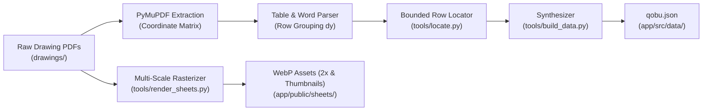

# Data Ingestion & Extraction Pipeline

This document outlines the technical pipeline that transforms the 205 raw construction drawing sheets into verified structured data, bounding boxes, and interactive raster assets.

---

## 🔄 Pipeline Workflow



---

## 🧭 Coordinate Space & Orientation Handling

A critical challenge in the Qobu package is that structural (`KS`) and building services (`MEP`) drawing sheets are saved rotated $270^\circ$ inside the PDF container.

If raw word coordinates are read directly, bounding boxes appear sideways or in inverted coordinate space. To resolve this deterministically:

```python
# From tools/locate.py
page = doc(code)[page_no - 1]
m = page.rotation_matrix
words_in_view = []
for w in page.get_text("words"):
    # w[:4] = (x0, y0, x1, y1) in unrotated PDF coordinate space
    r = pymupdf.Rect(w[:4]) * m
    words_in_view.append((r, w[4]))
```

Multiplying by `page.rotation_matrix` projects every text primitive into the **visual viewport coordinate space**, exactly matching the displayed orientation of the blueprint.

---

## 🎯 The Bounded Row Locator Algorithm

The `locate()` algorithm in `tools/locate.py` ensures zero hallucinations:

1. **Target Matching:** Filters sheet words where normalized text matches the target quantity string (e.g., `"1109.10"` or `"21830.4"`).
2. **Horizontal Context Alignment:** For each candidate number, scans horizontally within vertical tolerance ($\Delta y \le 6.5\text{ pt}$) for the cited row labels (e.g., `"Döşəmə tavası"`, `"B25"`, `"m³"`).
3. **Minimum Distance Scorer:** Scores candidate rows by horizontal proximity between the number and its qualifying labels.
4. **Bounding Box Union:** Computes the bounding box rectangle covering both the quantity and its label context, with $2.5\text{ pt}$ padding.
5. **Contextual Quote Extraction:** Collects all text primitives in the same row within horizontal proximity to generate the exact audit quote (e.g., `"Monolit d.b döşəmə tavası Dt-1 Beton B25 m³ 1109.10"`).

If a cited number or label is not found on the cited sheet, the build halts with an exception. **Nothing enters the Bill of Quantities without validated drawing proof.**

---

## 🖼️ High-Resolution Rasterization Engine

To deliver instant, lag-free pan and zoom in the browser without loading multi-megabyte PDFs on client devices:

- `tools/render_sheets.py` uses PyMuPDF's C rendering engine at $2.0\times$ matrix zoom (`alpha=False`).
- Raster pixmaps are converted to **WebP format** at quality `82`, reducing 205 sheets (over $67\text{ MB}$ in vector PDF) to compact, retina-sharp image tiles.
- Matching $360\text{ px}$ thumbnails (`.t.webp`) are generated for the sheet drawer, contact sheets, and generation sequence.

